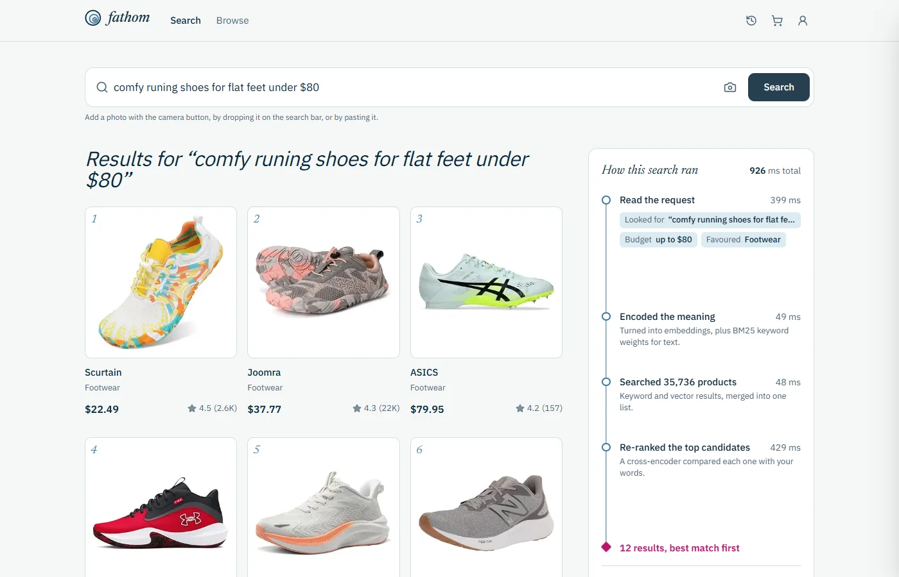
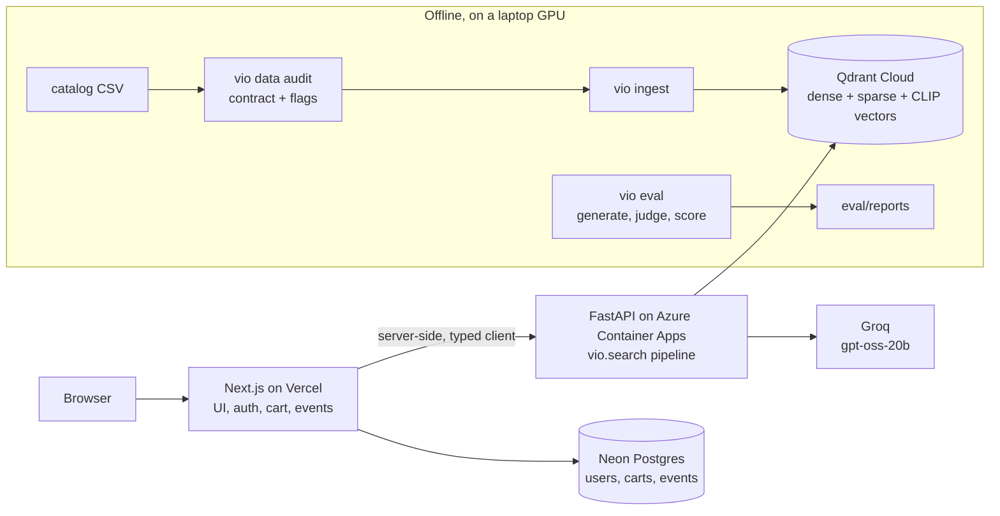

# Fathom: multimodal product search with measured AI

[](https://github.com/anassoooo/fathom-search/actions/workflows/ci.yml)
[](https://github.com/anassoooo/fathom-search/actions/workflows/deploy-backend.yml)

Search **35,736 Amazon products** by text or photo. Hybrid retrieval (dense +
BM25 + CLIP) is fused server-side and reranked by a cross-encoder, and an LLM turns
requests like *"comfy runing shoes for flat feet under $80"* into a clean query, a hard
budget, and a category boost. Every stage is **evaluated offline**, and the data was
**audited before it was trusted**.

[](https://fathom-search.vercel.app)

- **Live app:** https://fathom-search.vercel.app
- **Live API (Swagger):** https://vio-search-api.icyrock-a72fa589.germanywestcentral.azurecontainerapps.io/docs
  (scales to zero: the first request after idling takes up to a minute)

> Internal codename: `vio` (Python package, CLI, and cloud resource names).
>
> Engineering rules: [CONSTITUTION.md](CONSTITUTION.md) · design: [PLAN.md](PLAN.md) ·
> progress: [TASKS.md](TASKS.md) · decisions: [docs/adr/](docs/adr/) ·
> deployment: [docs/DEPLOYMENT.md](docs/DEPLOYMENT.md)

## Results

**Retrieval** ([full report](eval/reports/2026-10-11-ecd21ae.md)): text queries, LLM-judged
relevance (0/1/2) with TREC-style pooling, 95% bootstrap CIs, ▲ = better than BM25 by a
paired bootstrap test (p < 0.05).

| Variant | What it adds | NDCG@10 | Recall@10 | Recall@50 | MRR@10 | p50 latency* |
|---|---|---|---|---|---|---|
| `bm25` | keyword baseline | 0.745 | 0.483 | 0.807 | 0.821 | 28 ms |
| `dense` | bge-small embeddings | 0.776 | 0.529 | 0.863 | 0.842 | 36 ms |
| `hybrid` | dense + BM25 + CLIP text→image, RRF | 0.747 | 0.498 | **0.948 ▲** | 0.866 | 77 ms |
| `hybrid_rerank` | + MiniLM cross-encoder | 0.803 ▲ | 0.520 ▲ | 0.948 ▲ | 0.906 ▲ | 111 ms |
| **`full`** | + LLM query understanding | **0.813 ▲** | **0.557 ▲** | 0.944 ▲ | **0.913 ▲** | 120 ms |

\*Local RTX 3050, LLM call cached. On the free-tier Azure CPU, `full` takes ~1 s.

What the table shows:
- **Hybrid fusion finds far more of the relevant products** (Recall@50 0.81 → 0.95), but
  ranks them worse than dense alone; the **reranker** recovers the ordering (NDCG 0.75 → 0.80).
- **On budget queries, LLM query understanding matches an oracle.** With the true budget
  given to the system, Recall@10 is 0.762; with the budget extracted by the LLM it is 0.757.
- **Caveats, stated rather than hidden:** 49 of 325 queries are judged so far (judging runs
  daily within the free LLM quota); `full`'s results were not yet in the judging pool, so its
  numbers are a lower bound; and generated "specific" queries reuse 95% of title words,
  which flatters BM25 (per-bucket overlap is in the report).

**Query understanding** ([report](eval/reports/understanding-2026-10-10-16aa3ba.md)), `gpt-oss-20b` on 275 queries:

| Metric | Result |
|---|---|
| Valid structured output | 275/275 |
| Budget extracted exactly | 50/50 |
| Invented a price filter when none was stated | 0/225 |
| Typo repair (similarity to the clean query) | 0.971 → 0.991 |
| Category correct when it commits | 79.7%, which led to treating it as a **soft boost, not a filter** (the "errors" are the catalog's overlapping departments) |

**Data quality** ([report](data/reports/quality_report.md)): the catalog passes a
23-check contract before ingestion.
- The source "Bayesian rating" used **median price as its prior strength** (a unit error).
  It is replaced by an **empirical-Bayes prior** fitted on the data: m = 43 reviews, 95% CI
  38–51, validated on simulated data ([ADR-0003](docs/adr/0003-empirical-bayes-rating-prior.md)).
- **42,427 rows → 35,736 products** after merging duplicate listings by
  title + price + image ID ([ADR-0002](docs/adr/0002-dedup-and-category-aliases.md)).
- **Confident learning** flags 4.3% of products as category disagreements. A manual audit
  found 12.5% real errors (keyword collisions in the scrape, e.g. a PlayStation *"Pulse"*
  headset under *Groceries › Pulses*) and 72.5% taxonomy overlap.

## Architecture



**Search pipeline** (one Qdrant Query API call, then rerank):

1. **Understand** (`full` only): the LLM returns validated JSON with `search_text`, price range,
   price intent, and category. Prices become hard filters; the category becomes a soft boost.
2. **Encode** the query with bge-small (dense), BM25 (sparse), and CLIP (text→image); or
   CLIP vision for a photo.
3. **Retrieve**: each source is a prefetch with filters applied inside it, fused with **RRF**.
   The category boost adds extra in-category prefetches, so nothing is excluded.
4. **Rerank** the top 30 with a MiniLM cross-encoder, with a timeout fallback.
5. **Degrade, don't fail**: an LLM, reranker, or image failure falls back and reports
   `degraded: [...]`.

## Engineering

| Area | What's there |
|---|---|
| Stack | Python 3.12, FastAPI, Qdrant, fastembed (ONNX; CPU or CUDA), Groq (OpenAI-compatible), Next.js 16, Prisma, Postgres |
| Tests | 183 unit tests (in-memory Qdrant, fake encoders/LLM) + 9 integration tests (real Qdrant, real ONNX models); ruff + strict mypy |
| CI/CD | GitHub Actions: lint, types, tests, the data contract on the committed sample, web build; backend auto-deploys to Azure via **OIDC** (no stored cloud credentials) and smoke-tests `/health` |
| Evaluation | Query generation in 6 buckets from unflagged seeds, LLM judge with resumable incremental judging under a free-tier quota, bootstrap CIs, paired significance tests, a human-audit tool with Cohen's κ |
| Data | Contract-driven audit (`data/contract.toml`), empirical-Bayes ratings, robust outliers, confident learning, quality flags stored in Qdrant |
| Security | bcrypt, 256-bit random sessions, zod validation, no account enumeration, admin-only metrics; secrets only in dashboards and gitignored files |
| Observability | JSON logs with request IDs and per-stage timings; online CTR per retrieval variant on `/metrics`; `/api/health` reports dependency status with error codes |

## Run it locally

Requires Docker, [uv](https://docs.astral.sh/uv/), and Node 22+. A Groq API key is
optional; without it, `full` falls back to `hybrid_rerank`.

```bash
docker compose up -d qdrant postgres          # Qdrant :6333, Postgres :5434

cd backend
uv sync --extra cpu                           # or --extra gpu with an NVIDIA GPU (then ONNX_DEVICE=cuda)
cp .env.example .env                          # paste a Groq key into LLM_API_KEY (optional)
uv run vio ingest --sample                    # 501-product sample; models download on first run
uv run vio serve                              # http://127.0.0.1:8000/docs

cd ../web
cp .env.example .env
npm ci && npx prisma migrate deploy
npm run dev                                   # http://localhost:3000
```

Useful commands: `uv run pytest`, `uv run vio data audit`, `uv run vio eval retrieval`,
`uv run vio eval understanding`.

## Repository layout

```
backend/   Python package `vio`: ingest, quality audit, search, LLM, eval, FastAPI
web/       Next.js app (UI + thin /api proxies to the backend)
data/      sample catalog, data contract, fitted prior, quality flags, eval sets, reports
eval/      retrieval and query-understanding reports
docs/      ADRs, architecture, deployment
notebooks/ original exploration notebooks (EDA, legacy embedding upload)
scripts/   daily evaluation job (Windows Task Scheduler)
```

## Limitations

- **The evaluation is partial and LLM-judged:** 49/325 queries so far. The judge seems sane
  (it rated every seed product relevant in 49/49 queries), but agreement with human labels
  (Cohen's κ) isn't measured yet.
- **Product text is title-only**, and 12% of titles are just a brand (97% of Footwear), so
  those products depend on image vectors.
- **When a request gives both a budget and "luxury", the luxury intent is dropped**
  (prompt v1); a v2 prompt is planned.
- **Free-tier hosting:** the backend scales to zero, and reranking on 1 vCPU takes ~440 ms
  vs ~11 ms on a GPU.

## License

MIT. See [LICENSE](LICENSE).
