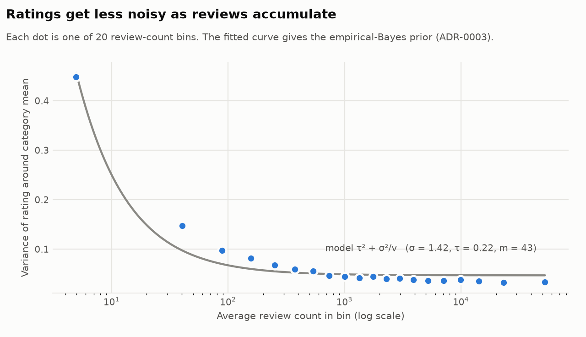
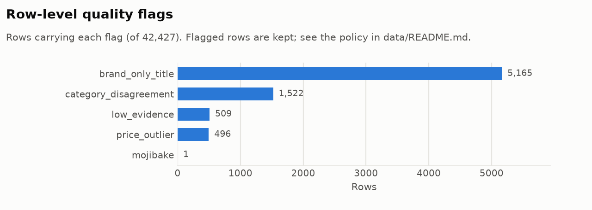
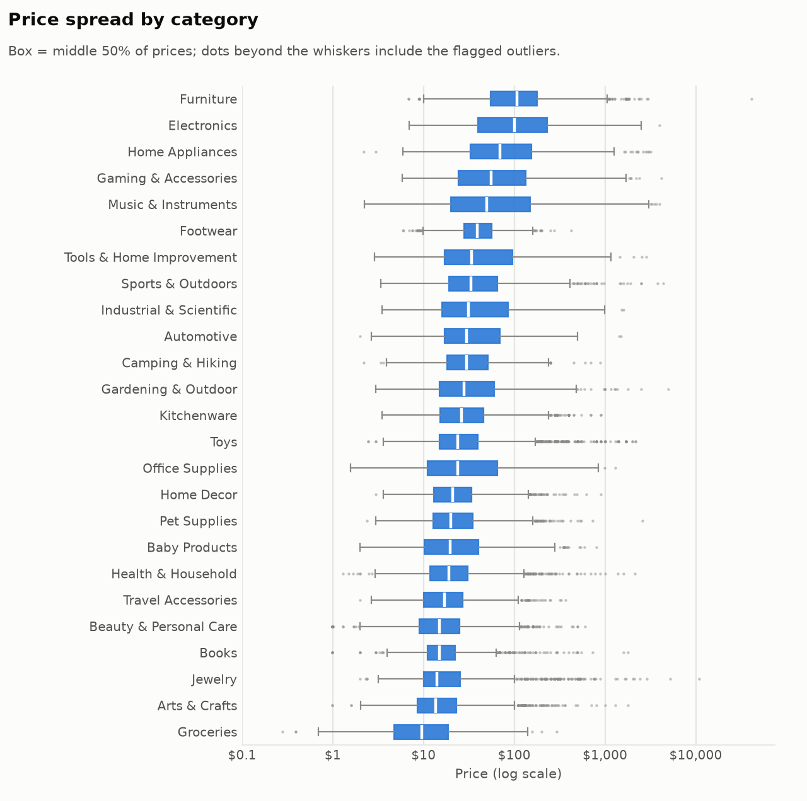
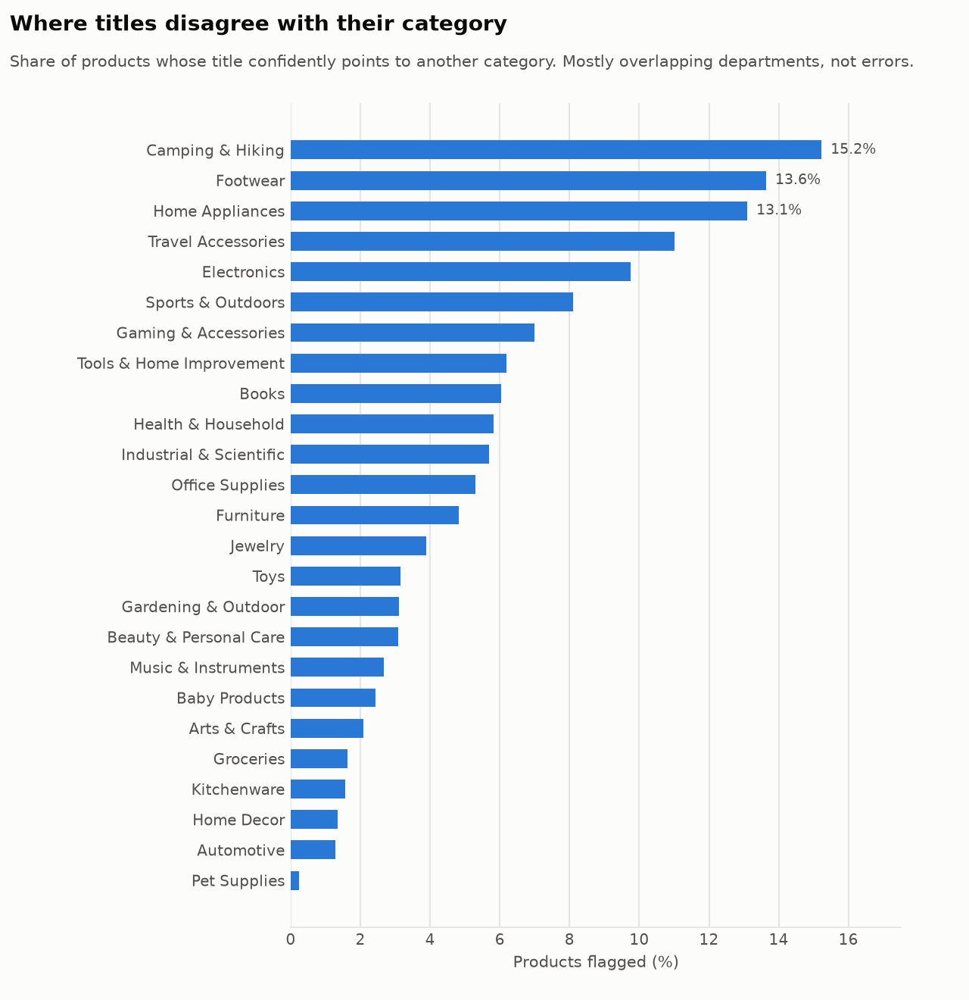

# Catalog data-quality report

- **Source:** `data/processed/vio_EDA.csv`
- **Rows:** 42,427
- **Generated:** 2026-10-10 by `vio data audit`
- **Verdict:** **TRUSTED**
- **Checks:** 23/23 passed; 0 blocking failures

Severity: *blocking* stops ingestion; *warning* is ingested with row-level quality flags; *info* is recorded only. Thresholds come from `data/contract.toml`.

## Completeness

| Check | Severity | Metric | Threshold | Status | Affected |
|---|---|---|---|---|---|
| `completeness.required_fields` Share of rows missing id, name, category, or price | blocking | 0 | <= 0 | pass | 0 |
| `completeness.optional_fields` Null rate of optional fields (max over columns) | warning | 0 | <= 0.05 | pass | 0 |

<code>completeness.required_fields</code> details

- **null_counts:** `{"product_id": 0, "name": 0, "category": 0, "price": 0}`

<code>completeness.optional_fields</code> details

- **null_rates:** `{"subcategory": 0.0, "price_bucket": 0.0, "rating": 0.0, "total_ratings": 0.0, "bayes_rating": 0.0, "value_score": 0.0, "image_url": 0.0}`

## Uniqueness

| Check | Severity | Metric | Threshold | Status | Affected |
|---|---|---|---|---|---|
| `uniqueness.product_id` Rows whose Product ID is not unique | blocking | 0 | <= 0 | pass | 0 |
| `uniqueness.duplicate_listings` Share of rows repeating another listing (title, price, image); merged at ingest (ADR-0002) | warning | 0.1577 | <= 0.2 | pass | 6,691 |

<code>uniqueness.duplicate_listings</code> details

- **groups:** `5362`

## Validity

| Check | Severity | Metric | Threshold | Status | Affected |
|---|---|---|---|---|---|
| `schema.required_columns` All expected columns are present | blocking | 0 | <= 0 | pass | 0 |
| `validity.rating_range` Ratings outside [1, 5] | blocking | 0 | <= 0 | pass | 0 |
| `validity.price_positive` Prices that are non-numeric, zero, or negative | blocking | 0 | <= 0 | pass | 0 |
| `validity.review_count` Review counts that are negative or not whole numbers | blocking | 0 | <= 0 | pass | 0 |
| `validity.price_bucket_domain` price_bucket values outside {cheap, mid, premium} | blocking | 0 | <= 0 | pass | 0 |
| `validity.image_url` Share of image URLs matching the Amazon CDN pattern | warning | 1 | >= 0.99 | pass | 0 |
| `validity.rows_parse` Rows rejected by the Product model (types, ranges, enums) | blocking | 0 | <= 0 | pass | 0 |

<code>schema.required_columns</code> details

- **missing:** `[]`

## Consistency

| Check | Severity | Metric | Threshold | Status | Affected |
|---|---|---|---|---|---|
| `consistency.bayes_rating_source` Max |error| reproducing source bayes_rating from its notebook formula (m = median price) | warning | 0.0001 | <= 0.001 | pass | 0 |
| `consistency.value_score_source` Max relative error reproducing value_score = bayes * ln(1 + reviews) / price | warning | 0.0000 | <= 1e-06 | pass | 0 |
| `consistency.price_bucket_source` Share of price_bucket values matching per-subcategory 30th/70th price percentiles | warning | 0.9999 | >= 0.99 | pass | 3 |

<code>consistency.bayes_rating_source</code> details

- **prior_strength_used:** `23.99`
- **prior_strength_unit:** `dollars (median price), a unit error; see ADR-0003`

<code>consistency.value_score_source</code> details

- **max_value_score:** `169.96`
- **note:** `upstream EDA dropped rows with value_score >= 1000 (very cheap item...`

## Plausibility

| Check | Severity | Metric | Threshold | Status | Affected |
|---|---|---|---|---|---|
| `plausibility.price_outlier` Share of prices with |robust z| > 3.5 on log(price) within subcategory and >= 3x from its median | warning | 0.0117 | <= 0.03 | pass | 496 |
| `plausibility.low_evidence_rating` Share of products rated by fewer than 5 reviews | warning | 0.0120 | <= 0.05 | pass | 509 |

<code>plausibility.price_outlier</code> details

- **high:** `331`
- **low:** `165`

| product_id | name | subcategory | price | x_median | robust_z |
|---|---|---|---|---|---|
| 5764 | Computer Cockpit Chair Family Deluxe Racing Executive Office Cockpi... | Gaming Chairs | 40922.03 | 454.74 | 13.6 |
| 39922 | Rolex | Men's watches | 10995.0 | 184.357 | 4.9 |
| 39637 | The Pearl Source | Necklaces | 2040.0 | 157.529 | 12.8 |
| 42882 | DEWALT 20V MAX Cordless Plumbing Pipe Press Tool Kit with Crimping ... | Plumbing tools | 2850.0 | 142.571 | 5.3 |
| 42849 | Milwaukee 2473-22 M12 Force Logic Press tool 1/2" - 1" Kit | Plumbing tools | 2049.9 | 102.546 | 5.0 |
| 38831 | 3M PAPR Respirator, Versaflo Powered Air Purifying Respirator Kit, ... | Respirators | 1608.81 | 59.608 | 6.3 |
| 2082 | Encyclopedia of Cardiovascular Research and Medicine(Volume 1-4) | Medical Books | 1800.0 | 56.533 | 3.8 |
| 28290 | Design Toscano The Fairy Gardener Garden Statue, Cast Bronze | Garden statues | 1281.99 | 51.3 | 13.0 |

<code>plausibility.low_evidence_rating</code> details

| product_id | name | rating | total_ratings |
|---|---|---|---|
| 49 | HP 14" Ultra Light Laptop for Student & Home (Intel Quad-Core N4120... | 4.1 | 4 |
| 53 | HP 15.6" Touchscreen Laptop Computer, 32GB RAM 1.5TB Storage (1TB S... | 5.0 | 2 |
| 113 | COSTWAY 18K BTU Dual 2 Zone Mini Split AC/Heating System, 22 SEER2 ... | 5.0 | 4 |
| 137 | 15000 Btus Portable Air Conditioner, 3-in-1 Portable AC Unit with R... | 1.0 | 1 |
| 161 | BLACK+DECKER 16.4 Cu. Ft. Top Mount Refrigerator with Freezer, 2 Do... | 5.0 | 1 |

## Text integrity

| Check | Severity | Metric | Threshold | Status | Affected |
|---|---|---|---|---|---|
| `text.mojibake` Titles containing U+FFFD (encoding lost upstream) | warning | 0.0000 | <= 0.001 | pass | 1 |
| `text.html_entities` Titles with unescaped HTML entities (&amp;, &#39;) | warning | 0 | <= 0.001 | pass | 0 |
| `text.brand_only_title` Titles of two words or fewer (often just a brand): little text signal for search | info | 0.1217 | measured | pass | 5,165 |
| `text.all_caps` Titles written entirely in capitals (> 10 letters) | info | 0.0026 | measured | pass | 110 |
| `text.whitespace` Titles with leading/trailing or repeated whitespace | info | 0 | measured | pass | 0 |
| `text.truncated` Titles ending in an ellipsis (likely truncated) | warning | 0.0013 | <= 0.01 | pass | 56 |

<code>text.mojibake</code> details

| product_id | name |
|---|---|
| 14695 | Meguiar�s Whole Car Air Refresher, Odor Eliminator Spray Eliminates... |

<code>text.brand_only_title</code> details

- **top_categories:** `{"Footwear": 1395, "Jewelry": 1262, "Travel Accessories": 551, "Toys": 296, "Groceries": 226}`

| product_id | name |
|---|---|
| 895 | The Housemaid |
| 920 | Fahrenheit 451 |
| 923 | Magic Hour |
| 932 | The Arrangement |
| 995 | Engineers |

<code>text.all_caps</code> details

| product_id | name |
|---|---|
| 200 | LG WM3555HVA COMBINATION WASHER ELECTRIC DRYER |
| 1405 | THINGS WE DON’T TALK ABOUT |
| 1524 | DAREDEVIL: BORN AGAIN [MARVEL PREMIER COLLECTION] |
| 2777 | LYNK PROFESSIONAL |
| 8696 | BIGPOWER ELECTRIC |

<code>text.truncated</code> details

| product_id | name |
|---|---|
| 652 | Wall Outlet Extender with Shelf and Night Light,Surge Protector,USB... |
| 2401 | Glaver's Drinking Glasses Set of 10 Highball Glass Cups, Premium Gl... |
| 2770 | Magnetic Spice Rack for Refrigerator, Kitchen Organizer and Storage... |
| 3059 | Original Vegetable Fruit Peeler Carbon Steel Blade 3 Pack Red/Green... |
| 3153 | Under Sink Organizers, Metal Pull Out Under Sink Organizers and Sto... |

## Label quality

| Check | Severity | Metric | Threshold | Status | Affected |
|---|---|---|---|---|---|
| `labels.category_disagreement` Share of products whose title confidently points to a category they are not listed in (confident learning, 5-fold out-of-fold). A manual audit found most are taxonomy overlap, not errors: see data/reports/label_noise_audit.csv | warning | 0.0426 | <= 0.08 | pass | 1,324 |

<code>labels.category_disagreement</code> details

- **classifier:** `TF-IDF word 1-2 + char 3-5 -> SGD logistic, 5-fold out-of-fold`
- **cv_accuracy:** `0.898`
- **cv_macro_f1:** `0.877`
- **products_scored:** `31092`
- **rate_by_category:** `{"Camping & Hiking": 0.1523, "Footwear": 0.1364, "Home Appliances": 0.131, "Travel Accessories": 0.1102, "Electronics": 0.0975, "Sports & Outdoors": 0.0811, "Gaming & Accessories": 0.07, "Tools & Home Improvement": 0.062, "Books": 0.0603, "Health & Household": 0.0581, "Industrial & Scientific": 0.0569, "Office Supplies": 0.0529, "Furniture": 0.0483, "Jewelry": 0.0388, "Toys": 0.0315, "Gardening & Outdoor": 0.0311, "Beauty & Personal Care": 0.0308, "Music & Instruments": 0.0268, "Baby Products": 0.0243, "Arts & Crafts": 0.0209, "Groceries": 0.0163, "Kitchenware": 0.0156, "Home Decor": 0.0134, "Automotive": 0.0128, "Pet Supplies": 0.0023}`
- **highest_noise_categories:** `{"Camping & Hiking": 0.1523, "Footwear": 0.1364, "Home Appliances": 0.131, "Travel Accessories": 0.1102, "Electronics": 0.0975}`

| product_id | name | category | suggested | p_given | p_suggested |
|---|---|---|---|---|---|
| 1868 | Polymer Clay 50 Colors, Modeling Clay for Kids DIY Starter Kits, Ov... | Books | Arts & Crafts | 0.003 | 0.987 |
| 38109 | 365 by Whole Foods Market | Arts & Crafts | Groceries | 0.001 | 0.983 |
| 37047 | La Roche-Posay Cicaplast Balm B5 UV SPF 50, Vitamin B5 + Shea Butte... | Camping & Hiking | Beauty & Personal Care | 0.003 | 0.986 |
| 39292 | Freshware Food Storage Containers [50 Set] 16 oz Plastic Deli Conta... | Industrial & Scientific | Kitchenware | 0.003 | 0.986 |
| 8323 | Custom Canvas Prints with Your Photos, Framed Canvas Print Many siz... | Toys | Home Decor | 0.001 | 0.985 |
| 6076 | Noahas Fluffy Area Rugs for Living Room,4x5.3 Feet Black Rugs for B... | Furniture | Home Decor | 0.004 | 0.985 |
| 7383 | Solar Globe Lights Outdoor Waterproof-Solar Balls for Garden-Cracke... | Furniture | Gardening & Outdoor | 0.002 | 0.983 |
| 10853 | 10 Inch Microwave Food Cover & Collapsible Silicone Mat - Splatter ... | Home Appliances | Kitchenware | 0.0 | 0.98 |

## Derived features: Bayesian rating

The source `bayes_rating` reproduces exactly from the notebook formula, but that
formula sets the prior strength *m* to the **median price** ($), a unit error.
VIO recomputes it with an empirical-Bayes prior fitted on the catalog (loaded from `data/derived_params.json`).

**Model.** θ_i ~ N(μ_category, τ²), R_i | θ_i ~ N(θ_i, σ²/v_i), so
Var(R - μ_c) = τ² + σ²·(1/v). Method: WLS of binned Var(R - mu_c) on mean(1/v), 20 quantile bins of review count; 95% CI from 200 bootstrap resamples of products.

| Parameter | Estimate |
|---|---|
| σ (per-review rating SD) | 1.425 stars |
| τ (between-product SD of true quality) | 0.217 stars |
| **m = σ²/τ²** (prior strength, in reviews) | **43.1** (95% CI 38.1 to 50.5) |
| m without the lowest-evidence bin (sensitivity) | 116.9 |
| Source formula's m (median price) | 23.99 |

Lowest-evidence bins (variance falls with evidence, as the model predicts):

| mean 1/v | Var(R - μ_c) | products |
|---|---|---|
| 0.20174 | 0.4479 | 2,135 |
| 0.02482 | 0.1470 | 2,159 |
| 0.01132 | 0.0974 | 2,085 |
| 0.00639 | 0.0815 | 2,115 |
| 0.00400 | 0.0677 | 2,119 |
| 0.00268 | 0.0592 | 2,126 |

**Impact vs the source column:** Spearman rank correlation 0.986; on average
93% of each category's top 10 is unchanged; mean |Δ| 0.011 stars,
max |Δ| 0.42.

**Limitations.** (1) The 1/v model fits imperfectly: among popular products variance
keeps falling, so excluding the lowest-evidence bin raises m to 117. The
full-range estimate is used because shrinkage only matters for low-evidence products.
(2) Products with < 50 reviews average ~0.13 stars lower than popular ones
(popularity bias), so shrinking them toward a mean computed from popular products
slightly flatters them.

## Label quality: manual audit of flags

A random sample of 40 flags (seed 7) was reviewed by hand
(`data/reports/label_noise_audit.csv`; reviewer: claude (dev annotation; needs human spot-check)).

| Verdict | Count | Share |
|---|---|---|
| taxonomy_overlap | 29 | 72.5% |
| model_wrong | 6 | 15.0% |
| error | 5 | 12.5% |

- **error**: the listing is wrong. **taxonomy_overlap**: the listing is valid in the source
  taxonomy and the suggested category is also valid. **model_wrong**: the listing is
  correct and the suggestion is not.
- **Precision for real errors: 12.5%** (Wilson 95% CI 5.5% to 26.1%), so about
  **166** (72 to 346) of the 1,324 flags
  are genuinely mislabeled, around 0.5% of products.
- The dominant pattern is **overlapping departments** in the source taxonomy (sunscreen
  under both Camping and Beauty; chairs under Furniture, Office, and Gaming). Real errors
  look like **keyword collisions in the original scrape**:

- *Kirkland Signature Purified Drinking Water, 16.9 Ounce, 40 Count*: listed under **Camping & Hiking > Water bottles** (drinking water filed as a water bottle (keyword collision))
- *Comfort Zone 12 inch Cradle Fan, 3 Speed Floor or Table Fan with180 De*: listed under **Industrial & Scientific > Industrial fans** (12-inch home cradle fan filed as industrial)
- *BeautifyBeauties Spray Bottle For Hair – Continuous Mister Spray Bottl*: listed under **Jewelry > Hair accessories** (hair spray bottle filed under Jewelry)
- *TAILI Extra Large Moving Bags, 4 Pack Blue Heavy Duty Totes For Storag*: listed under **Kitchenware > Storage containers** (moving bags filed under Kitchenware)
- *PlayStation Pulse 3D Wireless Headset for PS5, PS4, and PC - Gray Camo*: listed under **Groceries > Pulses** (PlayStation 'Pulse' headset filed under Groceries > Pulses (keyword collision))

**Policy (T085):** flagged products keep their listed categories and **gain the suggested
category** (valid in about 85% of
reviewed cases), so category filters stop missing them. Nothing is relabeled or dropped.

## Figures

## Row-level quality flags

7,510 of 42,427 rows (17.7%) carry at least one flag.

| Flag | Rows |
|---|---|
| `brand_only_title` | 5,165 |
| `category_disagreement` | 1,522 |
| `low_evidence` | 509 |
| `price_outlier` | 496 |
| `mojibake` | 1 |
