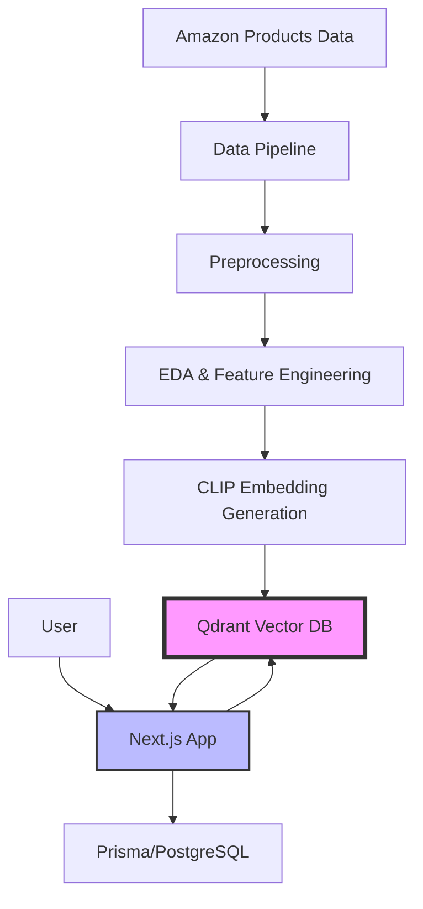
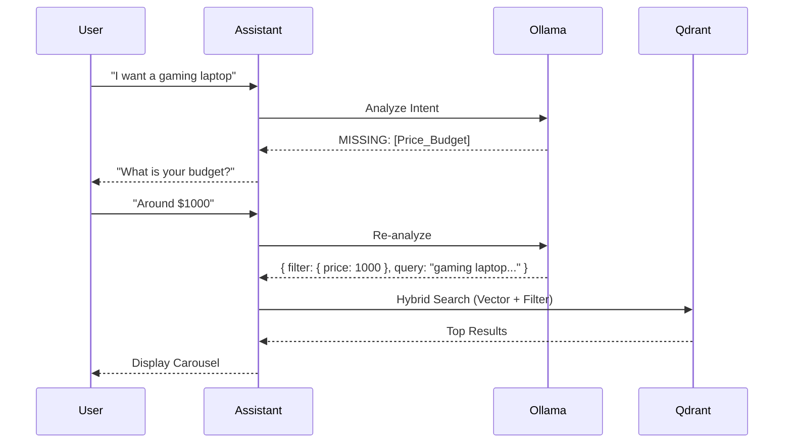
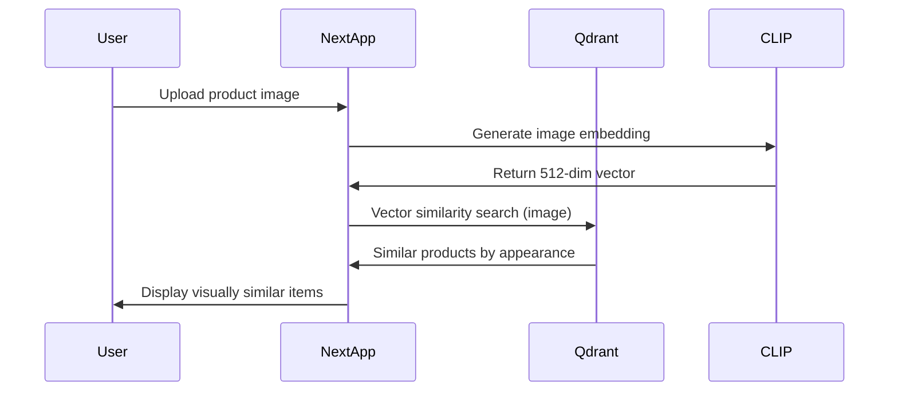
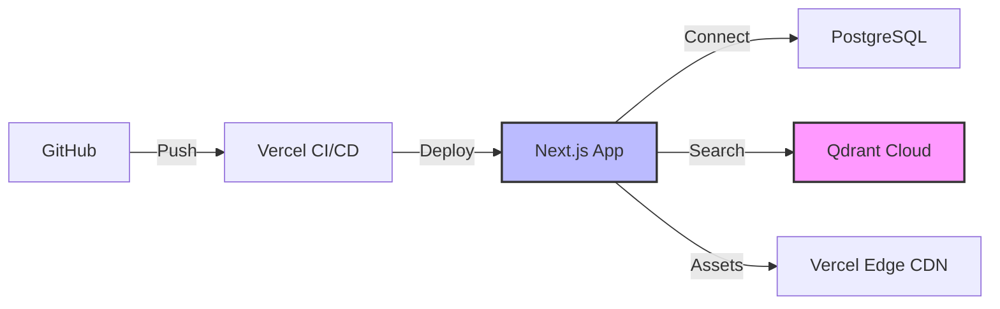

# VIO Shop Architecture

## System Overview

VIO Shop is an AI-powered e-commerce platform consisting of two main components:

1. **Web Application** (Next.js) - User-facing storefront
2. **Data Pipeline** (Python) - Product data processing and embedding generation



## Component Architecture

### Web Application

**Technology Stack**:
- **Frontend**: Next.js 16 with React Server Components
- **UI**: Radix UI + Tailwind CSS
- **Database**: Prisma ORM (PostgreSQL in production)
- **Vector Search**: Qdrant Cloud
- **Authentication**: NextAuth.js
- **Hosting**: Vercel

**Key Features**:
- Server-side rendering for SEO
- Semantic product search using vector embeddings
- Image-based product search
- AI-powered recommendations
- User authentication and profiles

### AI & Data Pipeline

**Technology Stack**:
- **Intent Engine**: Ollama (running Llama 3 / Qwen locally)
- **Embeddings**: OpenAI CLIP (Multimodal 512-dim)
- **Vector DB**: Qdrant (Hybrid Search + Payload Filtering)
- **Data Processing**: Python 3.8+, PyTorch, Pandas

### Intelligence Architecture

**1. Assistant Logic (The "FinCommerce" Brain)**
The `src/lib/ollama.ts` module acts as a reasoning layer between the user and the database.
*   **Input**: Natural language user query.
*   **Process**:
    1.  **Intent Extraction**: Identifies product types (e.g., "laptop") and constraints (e.g., "cheap").
    2.  **Clarification Check**: If critical info (Budget/Category) is missing, it returns a `missing_info` flag.
    3.  **Semantic Expansion**: Expands "gaming rig" to "high performance GPU, 144Hz screen, RGB".
    4.  **Payload Generation**: Converts "under $1000" into a strict Qdrant filter `price: { lte: 1000 }`.

**2. Data Pipeline Stages**:
1. **Raw Data Ingestion**: Amazon product CSV (42K products)
2. **Preprocessing**: Clean data, handle missing values
3. **Feature Engineering**: Calculate Bayesian ratings, value scores
4. **Embedding Generation**: CLIP text and image embeddings (512-dim)
5. **Vector Upload**: Batch upload to Qdrant with retry logic

## Data Flow

### Product Search Flow



### Image Search Flow



## Database Schema

### Qdrant Collection: `vio_products`

**Vector Configuration**:
- **text**: 512-dimensional CLIP text embedding (cosine similarity)
- **image**: 512-dimensional CLIP image embedding (cosine similarity)

**Payload Schema**:
```json
{
  "product_id": "12345",
  "title": "Nike Air Max Running Shoes",
  "price": 129.99,
  "rating": 4.5,
  "total_ratings": 1204,
  "category": "Sports & Outdoors",
  "subcategory": "Running Shoes",
  "bayes_rating": 4.47,
  "value_score": 85.3,
  "description": "Comfortable running shoes...",
  "image_url": "https://..."
}
```

### PostgreSQL Schema (via Prisma)

```prisma
model User {
  id        String   @id @default(cuid())
  email     String   @unique
  name      String?
  createdAt DateTime @default(now())
  favorites Favorite[]
  searches  Search[]
}

model Favorite {
  id         String   @id @default(cuid())
  userId     String
  user       User     @relation(fields: [userId], references: [id])
  productId  String
  createdAt  DateTime @default(now())
}

model Search {
  id        String   @id @default(cuid())
  userId    String?
  user      User?    @relation(fields: [userId], references: [id])
  query     String
  createdAt DateTime @default(now())
}
```

## Embedding Strategy

### Text Embeddings

Concatenate product metadata into a rich text description:

```
[Category] [Subcategory] - [Title]
Price: $[Price]
Rating: [Rating] stars ([Total Ratings] reviews)
[Description]
```

This allows the model to understand:
- Product type and category
- Price range (for value-based searches)
- Quality indicators (ratings)
- Detailed features

### Image Embeddings

Process product images through CLIP to capture:
- Visual appearance
- Color schemes
- Product design
- Style and aesthetics

## Scalability Considerations

### Current Scale
- **Products**: ~42,000
- **Vector Dimensions**: 512 (CLIP-base)
- **Storage**: ~100 MB in Qdrant
- **Search Latency**: <50ms

### Future Scaling Options
1. **Horizontal Scaling**: Shard Qdrant collection across nodes
2. **Model Upgrade**: Use CLIP-large (768-dim) for better accuracy
3. **Hybrid Search**: Combine vector search with traditional filters
4. **Caching**: Redis for popular search queries
5. **CDN**: CloudFlare for image delivery

## Security

- **API Keys**: Stored in environment variables, never committed
- **Database**: PostgreSQL with row-level security
- **Authentication**: JWT-based with httpOnly cookies
- **Rate Limiting**: Implemented at API routes
- **CORS**: Configured for production domains only

## Monitoring & Observability

**Suggested Tools**:
- **Application**: Vercel Analytics, Sentry
- **Database**: Prisma logging, Datadog
- **Vector DB**: Qdrant metrics dashboard
- **Performance**: Web Vitals, Lighthouse CI

## Deployment Architecture



**Production Environment**:
- **App Hosting**: Vercel (serverless functions)
- **Database**: Neon/Supabase PostgreSQL
- **Vector DB**: Qdrant Cloud
- **CDN**: Vercel Edge Network
- **Domain**: Custom domain with SSL

## Cost Estimation

**Monthly Operating Costs** (estimated):
- Vercel Pro: $20
- PostgreSQL (Neon): $10-25
- Qdrant Cloud: $25-50
- **Total**: ~$55-95/month

Can scale down to $0 using free tiers for development/demo.
